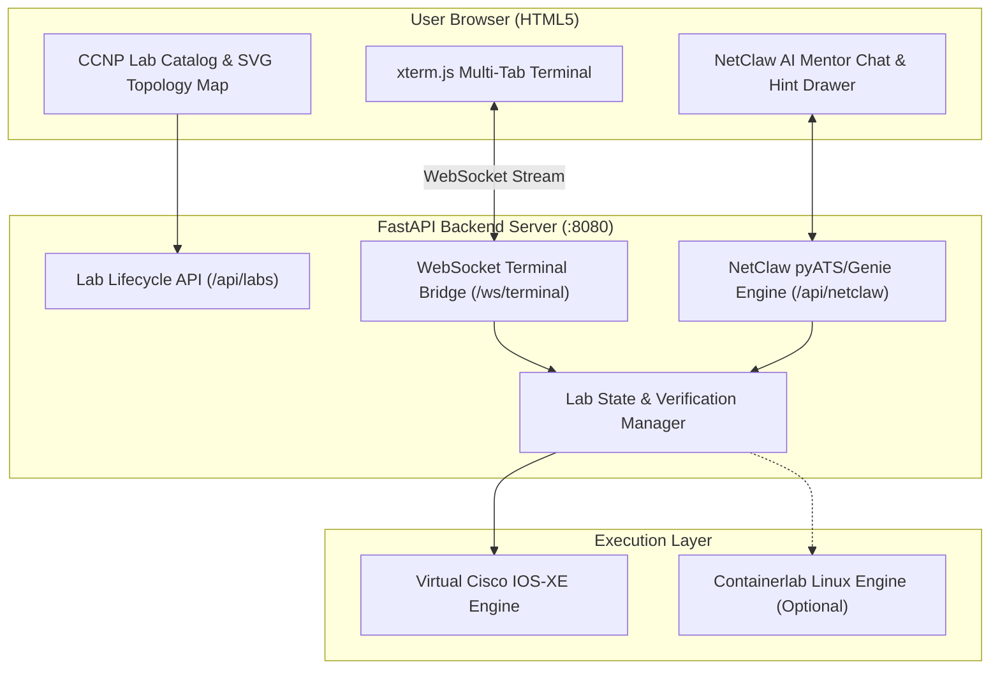

# Containerlab CCNP Web Studio with NetClaw AI Mentor

An interactive, browser-based network learning portal for CCNP candidates. Students troubleshoot and configure multi-vendor network topologies through locked-down in-browser terminals without exposing underlying images or infrastructure. An integrated **NetClaw AI Mentor** (powered by pyATS/Genie-style state parsing) acts as an intelligent NetOps coworker, providing real-time diagnostics and Socratic guidance.

---

## Key Features

1. **Curated CCNP Lab Scenarios:**
   - **CCNP ENCOR 350-401:** OSPFv2 Neighbor Adjacency & MTU Mismatch.
   - **CCNP ENCOR 350-401:** iBGP Route Reflector & Split-Horizon Troubleshooting.
   - **CCNP ENARSI 300-410:** Route-Map Policy & Prefix Redistribution Filtering.

2. **Multi-Tab HTML5 In-Browser Terminal & Cisco CLI Engine:**
   - Real ANSI terminal emulation powered by **xterm.js** and WebSockets.
   - **Cisco IOS Word-by-Word Tab Completion:** Full hierarchical grammar engine completing commands token by token (<kbd>Tab</kbd>) without jumping focus.
   - **Universal Cisco Command Abbreviations:** Accepts real Cisco shorthand (`sh ip ro`, `conf t`, `int gi0/1`, `no sh`, `rou bgp 65001`, `nei 10.0.2.3 rr`) across every lab!
   - Context-sensitive help (`?`), command history (`Up`/`Down` arrows), and pipe filtering (`| inc`, `| sec`).
   - Separate tabs for each device in the topology (`R1`, `R2`, `R3`).
   - Direct execution in router privilege mode with zero host shell or Docker socket access.
   - Quick CLI action chips (`show ospf`, `show bgp`, `show run`, etc.).
   - Responsive auto-resizing when panels are collapsed or expanded.

3. **Collapsible Layout & Full Terminal Focus:**
   - **Collapsible Objective Box:** Toggle the objective with `[Hide] / [Show]` to save vertical space.
   - **Collapsible Topology Map:** Minimize the SVG topology with `[▾] / [▸]` on demand.
   - **Sidebar Toggles:** Use the header icon buttons (`[◧]` and `[◨]`) to collapse the left lab panel or right AI mentor panel for a distraction-free, full-width terminal!

4. **Post-Lab Viewpoint Questions & Certification Cheat Sheet:**
   - **Architectural Recall & Viewpoint Questions:** 3 deep-dive conceptual questions per lab with "💡 Reveal Explanation" accordions.
   - **Key Exam Practice Commands:** Curated ENCOR/ENARSI test commands with purpose and Cisco exam tips.
   - **Interactive CLI Execution:** Click "▶ Run in CLI" chips directly from the debrief dialog to execute commands in the terminal.
   - **AI Mentor Debrief Mode:** Prompt NetClaw or your Personal AI to quiz you on your answers and evaluate your exam readiness.

5. **Dual AI Mentors (Local NetClaw + BYOK Personal Cloud AI):**
   - **🤖 NetClaw (Local NetOps Agent):**
     - Powered by John Capobianco's NetClaw framework.
     - Uses **pyATS Genie parsers** for zero-cost, deterministic operational state inspection without hallucination.
     - One-click **"Review Configs"** and 3-tier Socratic hints.
   - **🧠 Personal Cloud AI Agent (BYOK - Bring Your Own Key):**
     - Supports **Google Gemini** (`gemini-3.8-flash`, `gemini-1.5-flash`), **Anthropic Claude** (`Claude 3.5 Sonnet`), **OpenAI** (`GPT-4o`), and a **Built-in Offline CCIE Brain**.
     - **Live Telemetry & Config Injection:** Automatically pulls all current router running configurations, interface states, and pyATS parsed tables directly into the cloud LLM prompt.
     - Keys are stored securely in the browser's `localStorage` and never saved to the server filesystem.
     - Automatic 503 high-availability failover to offline CCIE Brain during cloud spikes.

6. **Instant Reset & Automated Grading:**
   - **Reset Lab:** Restores baseline seeded broken configurations in seconds.
   - **Verify Solution:** Runs automated pyATS-style verification checks, opens the debrief dialog, and displays the score checklist.

7. **Dual Execution Engine:**
   - **Standalone Virtual Engine:** Built-in Cisco IOS XE state simulator for instantaneous testing on any machine without Docker setup.
   - **Live Containerlab Engine:** Seamlessly connects to real Docker/Linux Containerlab topologies via `topology.clab.yml` and `configs/*.cfg`.

---

## Quick Start

### 1. Requirements
- Python 3.10+
- Dependencies: `fastapi`, `uvicorn`, `websockets`, `pydantic`, `httpx`

### 2. Launch the Web Studio
```bash
python run.py
```

### 3. Open in Browser
Navigate to:
```
http://localhost:8080
```

---

## Architecture



---

## Project Structure

```
NetLabCCNP/
├── app/
│   ├── config.py                 # Server settings & paths
│   ├── models.py                 # Pydantic request/response schemas
│   ├── cisco_cli.py              # Cisco IOS CLI Grammar & Tab completion engine
│   ├── lab_manager.py            # Lab catalog, virtual router simulator & verification
│   ├── netclaw_service.py        # NetClaw AI Mentor pyATS diagnostic service
│   ├── personal_agent_service.py # BYOK Cloud AI service (Claude, Gemini, OpenAI, CCIE Brain)
│   ├── terminal_server.py        # WebSocket handler for xterm.js sessions with Cisco ANSI
│   ├── main.py                   # FastAPI REST & WebSocket entrypoint
│   ├── labs/                     # CCNP lab definitions, viewpoints & seed configs
│   │   ├── encor_ospf_mtu/       # Lab 1: OSPF MTU Mismatch
│   │   ├── encor_bgp_rr/         # Lab 2: BGP Route Reflector
│   │   └── enarsi_route_map/     # Lab 3: Route-Map Redistribution
│   └── static/                   # HTML5 Web Interface
│       ├── index.html            # Main dashboard & debrief modal
│       ├── css/style.css         # Dark NetDevOps theme & debrief styling
│       └── js/
│           ├── app.js            # Main UI orchestrator & debrief coordinator
│           ├── topology.js       # Interactive SVG topology renderer
│           ├── terminal.js       # Multi-tab xterm.js manager & Tab key trap
│           ├── netclaw.js        # NetClaw AI Mentor client
│           └── personal_agent.js # BYOK Cloud AI client & key manager
├── requirements.txt              # Python package dependencies
├── run.py                        # Server launch script
└── README.md                     # Project documentation
```
